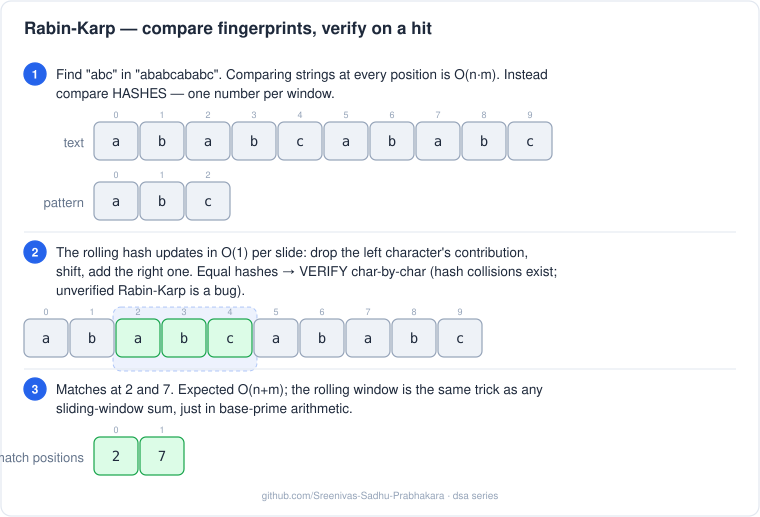

# Rabin–Karp String Matching

> Striver SDE Sheet 097 · Day 15 String — a rolling hash slides the window in O(1); only hash collisions pay for a real comparison. Go, stdlib only, tested.

## Problem

Find every occurrence of a pattern in a text. The naive scan re-compares m characters at each of n positions; Rabin–Karp replaces that with an O(1) hash update per slide.

## Approach

Treat each window as a number in base 256 modulo a large prime. Sliding one position is arithmetic: subtract the outgoing character's contribution (its value times base^(m−1), precomputed), multiply by the base, add the incoming character — three operations regardless of m. Equal hashes are only *probable* matches, so every hit is verified with a direct comparison; the prime modulus makes spurious hits rare enough that expected time stays linear. The `(x−y%mod+mod)%mod` dance keeps the subtraction non-negative. Rabin–Karp's real superpower over KMP: hashing generalizes to 2-D pattern matching and to searching many patterns at once.

**Complexity:** O(n+m) expected, O(n·m) adversarial worst case; O(1) space.

## Visual walkthrough

Read the picture top to bottom — each numbered frame is one moment of the algorithm
running on this repo's test example.

## Run

    go test ./...   # verify
    go run .        # demo

---

One of 191 repos solving Striver's SDE Sheet in Go — stdlib only, one problem per repo, every solution tested. Browse the set: [`dsa-*` repos](https://github.com/Sreenivas-Sadhu-Prabhakara?tab=repositories&q=dsa-&type=source).
